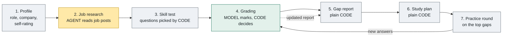
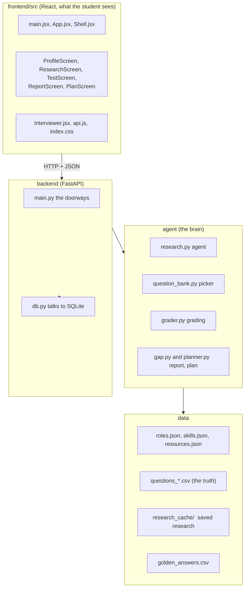

# AI Interview Coach

An open-source coach for students preparing for data and AI jobs.
A student picks a role and a company. The coach **researches what the job asks for**, **tests the student** with its own question bank, **shows the gaps**, builds a **study plan**, and runs a **practice round** on the weakest skills.

> Demo project. Built only with open-source tools. The language model runs on your own computer through Ollama.

## The whole flow in one picture



**One rule runs through the whole project: the model judges, the code decides.**
The model reads pages and marks single rubric points. Plain code checks every claim, adds up the scores, and writes every sentence the student sees, using templates filled with our own data.

| Step | What the model does | What the code does |
|---|---|---|
| Research | Chooses what to search and read, and lists skills with quotes | Stops it after 2 pages, **drops any skill whose quote is not on the page**, fills gaps from the role profile |
| Test | Nothing | Picks questions by skill importance and difficulty |
| Grading | Marks **one rubric point at a time** (yes, partly or no) and quotes the student | Checks the quote, demotes unproven marks, adds up the score, writes the feedback |
| Report and plan | Nothing | All arithmetic and all text |

## Quick start (Windows PowerShell)

You need Python 3.12, Node.js and the [Ollama](https://ollama.com) app.

**1. Install**
```
git clone https://github.com/kivar-ai/ai-interview-coach.git
cd ai-interview-coach
python -m venv .venv
.venv\Scripts\activate
pip install -r requirements.txt
ollama pull qwen3:8b
```
The model name can be changed with the `OLLAMA_MODEL` environment variable. The default is `qwen3:8b`.

**2. Load the question bank** (once, and again after editing any `data\questions_*.csv`)
```
python agent\question_bank.py
```
The first run downloads a small embedding model. Running it again is always safe.

**3. Start the backend** (terminal 1, from the project folder, with `.venv` active)
```
uvicorn backend.main:app --reload
```
Check it at <http://127.0.0.1:8000/health>.

**4. Start the screen** (terminal 2)
```
cd frontend
npm install
npm run dev
```
In PowerShell use `npm.cmd` if `npm` is blocked. Open <http://localhost:5173>.

## Demo mode

A full test takes a long time on a laptop, because every answer needs one model call per rubric point (1 to 2 minutes per answer). For demos:

```
$env:COACH_DEMO = "1"
uvicorn backend.main:app --reload
```
Demo mode picks **one question per skill** instead of 3, 2 or 1 by importance. Turn it off with `Remove-Item Env:COACH_DEMO`.

**Instant research.** These jobs are already researched and saved in `data\research_cache`. Any other company waits about 3 to 5 minutes the first time:

| Role | Company |
|---|---|
| Data Scientist | Infosys, TCS, Wipro, Cognizant, or no company |
| Data Analyst | Infosys |

For a clean start, delete the student database (it is git-ignored): `Remove-Item data\coach.db`.

## Project map



Not committed, built on your machine: `chroma_db/` (a searchable copy of the questions, rebuilt from the CSVs) and `data/coach.db` (the students and their answers).
`experiments/` holds early learning scripts and is not part of the app.

## Checks

| What | Command | Notes |
|---|---|---|
| Unit tests | `python -m unittest discover tests` | Fast. Uses a fake model, so it tests our code only |
| Question files | `python tools\validate_data.py` | Checks every CSV against `docs\QUESTION_FORMAT.md` |
| Grader accuracy | `python tools\golden_check.py` | Slow. Uses the real model on 30 answers with known scores |

## Status

| Built | Not built yet |
|---|---|
| Profile, job research with proof, skill test, background grading, gap report with gap map, study plan, voiced practice round | Progress over time, "ask a doubt", a live conversational mock interview |

Known limits:
- Marking takes about 1 to 2 minutes per answer on a CPU.
- Restarting the backend loses answers that were still waiting to be marked.
- Refreshing the page loses the current test.
- Only 5 skills have questions so far: Python, SQL, Statistics, Machine Learning (6 to 7 each) and LLM and GenAI (1).
- The report averages all attempts, so practice answers dilute improvement.
- The role profiles in `data\roles.json` are a draft and need review against real job posts.

## Learn more

- [`docs/ARCHITECTURE.md`](docs/ARCHITECTURE.md) - diagrams of how every part connects
- [`docs/API_CONTRACT.md`](docs/API_CONTRACT.md) - what the screen and the backend send each other
- [`docs/QUESTION_FORMAT.md`](docs/QUESTION_FORMAT.md) - how to write questions
- [`CONTRIBUTING.md`](CONTRIBUTING.md) - how we work together

## Coming back after a break

1. `git checkout main` and `git pull`
2. `.venv\Scripts\activate`
3. Open the Ollama app, then start the backend and the screen as in the quick start
4. For a demo: `$env:COACH_DEMO = "1"`, delete `data\coach.db`, and use a cached company

## Licence

MIT
