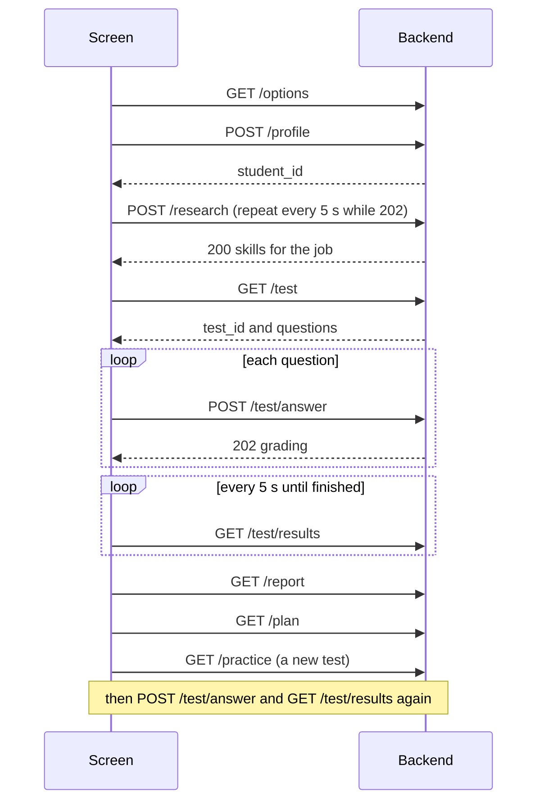

# API contract

This file is the single source of truth for what the **screen** sends and what the **backend** answers.
It matches the running backend (`backend/main.py`). Change it only through a pull request.

- Base address while developing: `http://127.0.0.1:8000`. The backend allows pages from `http://localhost:5173`.
- Every request and reply is JSON. Errors always look like `{"error": "short message"}`.
- Ids: skill ids come from `data/skills.json`, role ids from `data/roles.json`.
- Self-rating values: `beginner`, `intermediate`, `advanced`. Importance values: `high`, `medium`, `low`.
- Scores: one answer is a whole number from 0 to 10. A skill score in the report is 0 to 100.
- The backend also serves a live, clickable version of this page at <http://127.0.0.1:8000/docs>.

## The order of calls



| Endpoint | Purpose |
|---|---|
| `GET /health` | Is the backend alive |
| `GET /options` | Roles and skills for the profile screen |
| `POST /profile` | Save the student |
| `POST /research` | Research the job (the agent) |
| `GET /test` | Create a test and get its questions |
| `POST /test/answer` | Save one answer, marking starts in the background |
| `GET /test/results` | Progress and results of a test |
| `GET /practice` | Create a practice test on the biggest gaps |
| `GET /report` | The gap report |
| `GET /plan` | The study plan |

---

## 0. Health
`GET /health`

Response
```json
{"status": "ok"}
```

## 1. Options for the profile screen
`GET /options`

Response (shortened)
```json
{
  "roles": [{"id": "data_analyst", "name": "Data Analyst"}, {"id": "data_scientist", "name": "Data Scientist"}],
  "skills": [{"id": "python", "name": "Python"}, {"id": "sql", "name": "SQL"}]
}
```
There are 8 roles and 12 skills. The lists come straight from `data/roles.json` and `data/skills.json`.

## 2. Save the student profile
`POST /profile`

Request
```json
{
  "name": "Priya",
  "target_role": "data_scientist",
  "company": "Infosys",
  "job_description": null,
  "self_rating": {"python": "intermediate", "sql": "advanced", "statistics": "beginner"}
}
```
`name`, `target_role` and `self_rating` are required. `company` and `job_description` may be `null`.

Response
```json
{"student_id": "s_001"}
```
An unknown role or skill id gives an error reply.

## 3. Research the job (the agent)
`POST /research`

Request
```json
{"student_id": "s_001"}
```
- **`200`** the result is ready (instant when the role and company were researched before).
- **`202`** research is running. The screen asks again every 5 seconds until it gets `200`.

Response when ready
```json
{
  "role": "data_scientist",
  "role_name": "Data Scientist",
  "company": "Infosys",
  "skills": [
    {"skill": "sql", "importance": "high", "sources": ["https://example.com/job-post"], "basis": "web"},
    {"skill": "statistics", "importance": "high", "sources": [], "basis": "base_profile"}
  ],
  "pages_read": [
    {"url": "https://example.com/job-post", "read": true},
    {"url": "https://blocked.example.com", "read": false}
  ],
  "cached": false,
  "warnings": [],
  "dropped_unverified": [],
  "seconds": 180
}
```
`basis` says where a skill came from: `web` means a page we read proves it (`sources` holds the proof), `base_profile` means it comes from our own role profile (`sources` is empty). `warnings` are messages to show the student. `dropped_unverified` and `seconds` are for us, not for students.

## 4. Get the test questions
`GET /test?student_id=s_001`

Response
```json
{
  "test_id": "t_001",
  "total": 5,
  "questions": [
    {"question_id": "q_sql_001", "number": 1, "skill": "sql", "text": "What is the difference between INNER JOIN and LEFT JOIN?"}
  ],
  "skipped_skills": ["data_analysis", "communication"]
}
```
`skipped_skills` lists skills the job needs that have no questions yet. The rubric and ideal answer are never sent to the screen. Every call creates a **new** test.

## 5. Submit one answer
`POST /test/answer`

Request
```json
{"student_id": "s_001", "test_id": "t_001", "question_id": "q_sql_001", "answer": "INNER JOIN gives matching rows..."}
```
`answer` can be at most 4000 characters.

Response: **`202`**
```json
{"status": "grading"}
```
The answer is saved as pending and marked in the background, one at a time. The result is read from `GET /test/results`. An unknown student, test or question gives a `404`. An answer that cannot be accepted gives a `409`.

## 6. Progress and results of a test
`GET /test/results?student_id=s_001&test_id=t_001`

Response
```json
{
  "total": 5,
  "answered": 5,
  "graded": 2,
  "finished": false,
  "questions": [
    {
      "question_id": "q_sql_001", "number": 1, "skill": "sql",
      "text": "What is the difference between INNER JOIN and LEFT JOIN?",
      "status": "done",
      "score": 4, "max_score": 10,
      "feedback": "You covered INNER JOIN but not what LEFT JOIN keeps.",
      "missed_points": ["LEFT JOIN keeps all rows from the left table"]
    }
  ]
}
```
`status` is one of `pending` (waiting or being marked), `done`, `failed` (could not be marked, `feedback` says why) or `unanswered`. `score`, `max_score` and `feedback` are only filled when the status is `done`. `finished` becomes `true` when marking is complete. The screen asks every 5 seconds until then.

## 7. Practice round
`GET /practice?student_id=s_001`

Same reply as `GET /test` (section 4), with `skipped_skills` always empty. The questions come only from the student's biggest gaps, so the student needs at least one graded test first. If there are no gaps or no questions, the reply is a `409` error. Answers are then sent with `POST /test/answer` and read with `GET /test/results`, exactly as in a normal test.

## 8. The gap report
`GET /report?student_id=s_001`

Response
```json
{
  "skills": [
    {"skill": "sql", "job_needs": "high", "self_rating": "advanced", "measured_score": 77, "gap": 13},
    {"skill": "communication", "job_needs": "high", "self_rating": null, "measured_score": null, "gap": null}
  ],
  "top_gaps": ["sql"]
}
```
- `measured_score` is the average of the skill's graded answers in percent. It is `null` when the skill was never tested.
- `gap` is the target minus `measured_score`, never below 0. Targets: high 90, medium 70, low 50. It is `null` for untested skills.
- `self_rating` is `null` when the student did not rate the skill.
- `top_gaps` holds up to 3 tested skills that are below their target, biggest gap first.

## 9. The study plan
`GET /plan?student_id=s_001`

Response
```json
{
  "steps": [
    {
      "order": 1,
      "skill": "sql",
      "title": "Strengthen SQL",
      "tasks": [
        "Revise: HAVING can use aggregates and WHERE cannot",
        "Answer practice questions on SQL out loud, then check them against the key points."
      ],
      "resources": [{"title": "SQL Tutorial (W3Schools)", "url": "https://www.w3schools.com/sql/"}]
    }
  ]
}
```
One step for each of the top gaps. Up to 3 tasks are "Revise: ..." points the student missed, and one practice task is added. `resources` comes only from `data/resources.json` and can be empty.

---

## Planned, not built yet

These were in the first version of this contract. The practice round (section 7) took the place of the mock interview, and the rest are still to do.

| Idea | Planned endpoint |
|---|---|
| Live mock interview | `POST /interview/start`, `POST /interview/answer` |
| Progress over time | `GET /progress?student_id=...` |
| Ask a doubt | `POST /doubt` |
