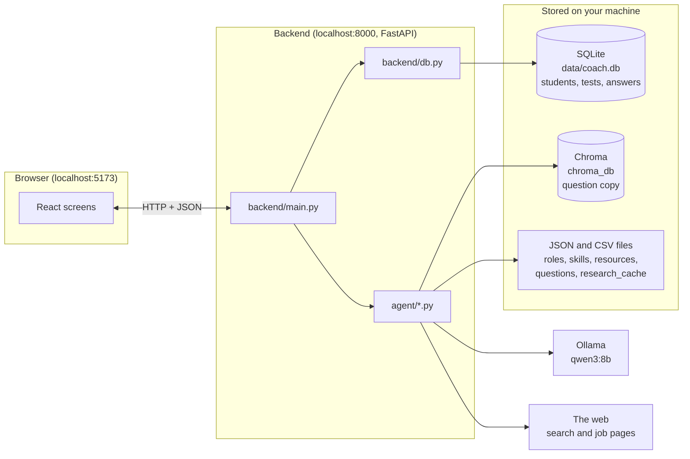
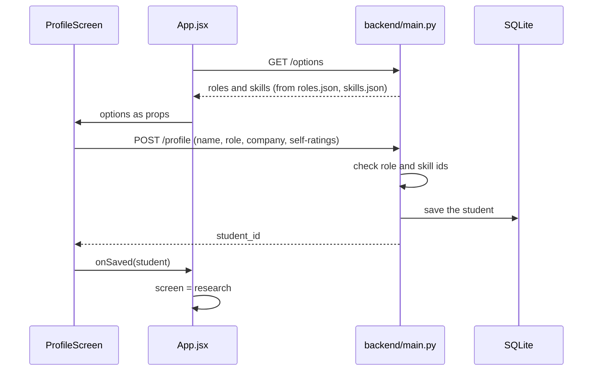
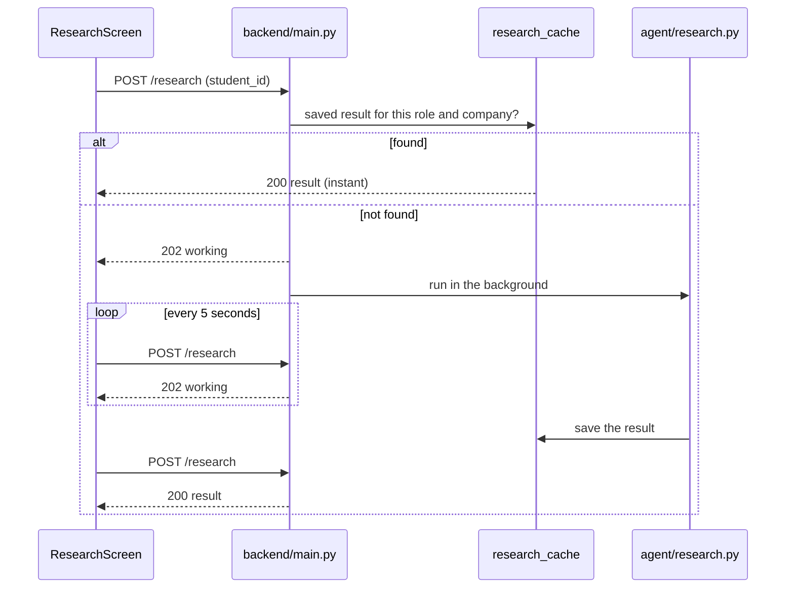
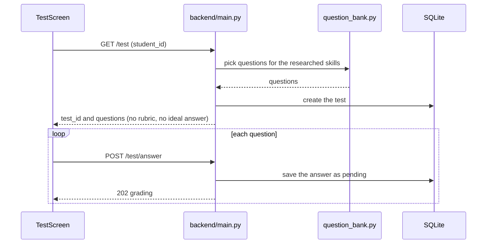
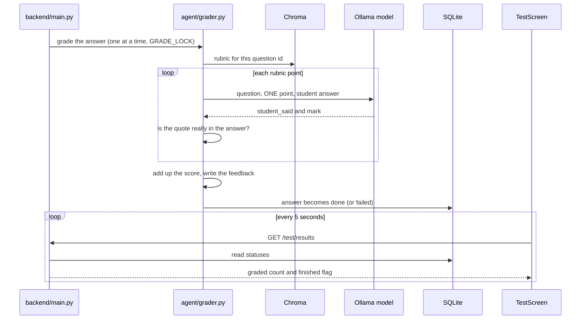
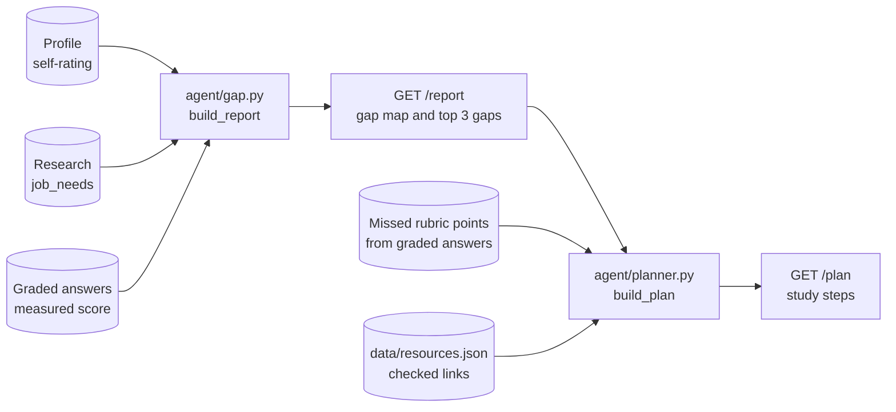
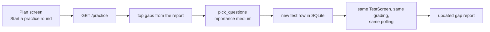
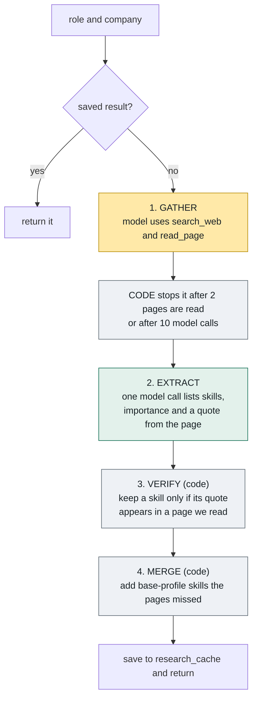
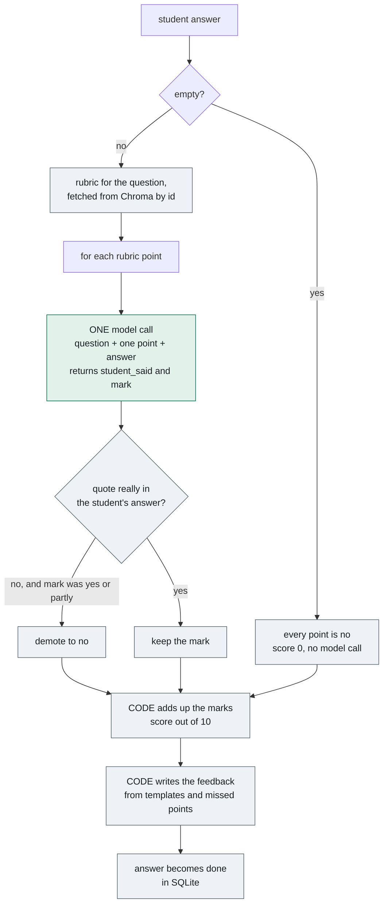
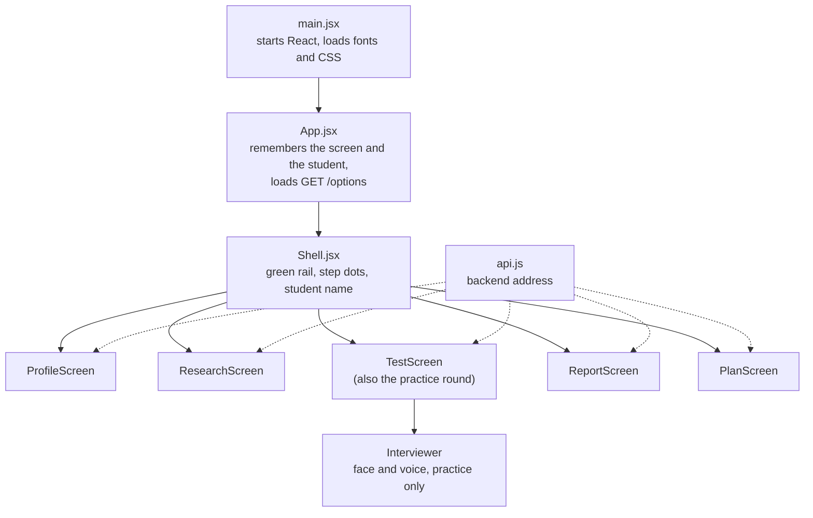

# Architecture

How the AI Interview Coach fits together. Read the pictures first, the notes second.

## 1. The system in one picture

The browser only draws screens and sends requests. The backend decides and saves. The two are separate programs, which is why they run in two terminals.

## 2. Two kinds of data

| | Reference data | Student data |
|---|---|---|
| What it is | The menu: roles, skills, questions, study links, saved research | The people: profiles, tests, answers |
| Lives in | `data/*.json`, `data/*.csv`, `data/research_cache/` | SQLite, `data/coach.db` |
| Written by | The team, by hand (research cache: by the agent) | The app, while students use it |
| In git | Yes | No |

`chroma_db/` is a third thing: a **built copy** of the questions CSVs, made for fast lookup. It can always be rebuilt with `python agent\question_bank.py`.

## 3. Step by step

### 3.1 Profile

Every later request carries the `student_id`. It is the key that ties research, tests, answers and reports to one person. It lives only in browser memory, so a page refresh forgets it.

### 3.2 Job research

### 3.3 Skill test and saving answers

The rubric and ideal answer never leave the backend.

### 3.4 Grading in the background

### 3.5 Gap report and study plan

Nothing here is stored. The report and plan are computed again on every request.

### 3.6 Practice round

The practice round reuses the test machinery. It only changes which questions are picked, and adds the voiced interviewer in the browser.

## 4. Inside the research agent

Tools used: `ddgs` for search, `trafilatura` to read pages, Ollama for the model. If the model tries to stop early, a guardrail sends it back to the tools, at most twice. Each skill in the result is labelled `web` (proven by a quote) or `base_profile` (from `data/roles.json`).

## 5. Inside the grader

An answer with 4 rubric points means 4 model calls, one after another. That is the reason marking takes 1 to 2 minutes on a CPU. Temperature is 0, so the same answer gets the same marks.

**How we know the grader is good.** `data/golden_answers.csv` holds 30 answers whose right score we already know. `tools/golden_check.py` runs the grader on them and checks it lands within 1 point. One call per rubric point scored 28 of 30. The answers were written by us, not by real students, so this is a good sign and not a guarantee.

## 6. How the gap is worked out (`agent/gap.py`)

| Importance | Target score |
|---|---|
| high | 90 |
| medium | 70 |
| low | 50 |

- **Measured score** = the average of the skill's graded answers, in percent, halves rounded up. A skill with no graded answer is "not tested".
- **Gap** = target minus measured score, never below 0.
- **Top gaps** = up to 3 skills that were tested and are below their target, biggest gap first.

Worked example: SQL is high need and scored 77, so the gap is 90 - 77 = 13. Python is medium need and scored 80, so the gap is max(0, 70 - 80) = 0, which means "on target".

The plan (`agent/planner.py`) takes each top gap and adds up to 3 tasks, each "Revise: " followed by a rubric point the student missed, plus one practice task. Links come only from `data/resources.json`.

## 7. The screen's components

`App.jsx` passes the student and the `options` lists down as props, and each screen calls back (`onSaved`, `onNext`, `onDone`, `onPractice`, `onRestart`) to move to the next screen.

## 8. The API at a glance

| Endpoint | Does |
|---|---|
| `GET /health` | Is the backend alive |
| `GET /options` | Roles and skills for the profile screen |
| `POST /profile` | Save the student, returns `student_id` |
| `POST /research` | Job research. 202 while working, 200 with the result |
| `GET /test` | Create a test and return its questions |
| `POST /test/answer` | Save an answer, grading starts in the background |
| `GET /test/results` | Progress and results of a test |
| `GET /practice` | Create a practice test on the top gaps |
| `GET /report` | The gap report |
| `GET /plan` | The study plan |

Errors always look like `{"error": "short message"}`.

## 9. Known limits

| Limit | Why |
|---|---|
| Restarting the backend loses answers waiting to be marked | The waiting list is in memory only |
| A page refresh loses the current test | The test and student id live in browser memory |
| Marking is slow | One model call per rubric point, on a CPU |
| Research has no time limit | A stuck page read can hang |
| 8 skills have no questions | Content is still to be written |
| The report averages all attempts | "Latest attempt only" is not built |
