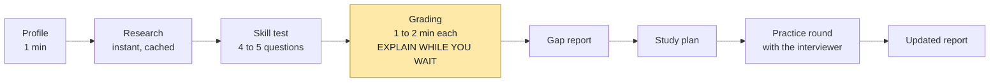

# Demo guide

How to show the AI Interview Coach without anything going wrong.

## The demo in one picture

Marking is the only slow part. Use that time to explain how the grader works (see "While you wait").

## Before you start (pre-flight)

| Check | How |
|---|---|
| Latest code | `git checkout main` then `git pull` |
| Ollama is running | Open the Ollama app. Check with `ollama list` |
| Clean database | `Remove-Item data\coach.db` (it is git-ignored) |
| Demo mode on | `$env:COACH_DEMO = "1"` in the backend terminal |
| Start the backend | `uvicorn backend.main:app --reload` |
| Start the screen | `cd frontend` then `npm run dev`, open <http://localhost:5173> |
| Warm up the model | Take one throwaway test answer first. Ollama unloads the model after about 5 idle minutes, so the first answer after a pause is slow |
| Cached company only | Data Scientist: Infosys, TCS, Wipro or no company. Data Analyst: Infosys |
| Voice works | Open the practice round once and listen. Voices differ from computer to computer |
| Quiet computer | Close other heavy programs, because they compete with the model for the CPU |
| Backup ready | A recorded video of a full run |

**Do not** restart the backend or refresh the page during the demo. Restarting loses answers that are still being marked, and refreshing loses the test.

## Script

| # | You do | You say | Time |
|---|---|---|---|
| 1 | Fill the profile: Data Scientist at Infosys, rate Python advanced, SQL intermediate, Statistics beginner | "The student tells us the job they want and how good they think they are." | 1 min |
| 2 | Click save. Research appears | "The coach already read real job posts for this company. Every green tag means it found a quote on a real page, and it checks the quote is really there." Point at one source link | 30 s |
| 3 | Start the test. Answer with the sample answers (two strong, two weak) | "Each question comes from our own question bank, with a hidden rubric the student never sees." | 3 min |
| 4 | Submit the last answer and wait | Explain the grader (below) | 4 to 8 min |
| 5 | Open the gap report | "Bars show the score. The yellow part is the gap to the target for this job. The black tick is what the student said about themselves." | 1 min |
| 6 | Open the study plan, click one link, tick a task | "The tasks come from the exact points the student missed. The links come from a checked list, never invented." | 1 min |
| 7 | Start the practice round | "A light mock interview on the weakest skills." Let the interviewer speak | 3 min |
| 8 | Open the updated report | "The report updates with the new answers." | 1 min |

## While you wait for the marks

Use the grader diagram in [`ARCHITECTURE.md`](ARCHITECTURE.md) (section 5). Three sentences are enough:

1. "The model marks one rubric point at a time. It must quote the student's own words."
2. "Code checks the quote is really in the answer. If not, the mark is cancelled."
3. "Code adds up the score and writes the feedback. The model writes no text the student reads."

If asked why it is slow: "One model call per rubric point, running on a laptop CPU. A graphics card or a faster model would make it much quicker."

## Sample answers

[`DEMO_ANSWERS.md`](DEMO_ANSWERS.md) has a good answer for every question in the bank, plus weaker ones at the bottom. For a realistic report, paste strong answers for 2 or 3 questions and weak ones for 2, so the report shows real gaps.

## If something goes wrong

| Problem | Do this |
|---|---|
| Research shows a timer | The company is not cached. Wait 3 to 5 minutes, or go back and pick a cached one |
| An answer shows "Could not be marked" | Carry on. The report uses the other answers. Check that Ollama is running |
| The page shows red text | Check the backend terminal is still running, then refresh and start again |
| No voice | Press "Replay question", or "Turn voice on". Typing still works |
| Marking looks stuck | Look at the backend terminal. If Ollama has stopped, restart it, and use the recorded video |

## Recording a video

- Record the screen and your voice with [OBS Studio](https://obsproject.com) (free and open source).
- Record the full run once with demo mode on, then cut or speed up the grading waits when you edit.
- Keep the video as a backup for the live session.
